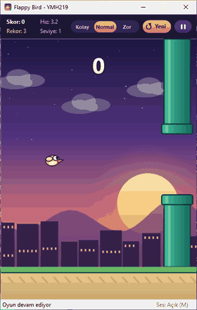
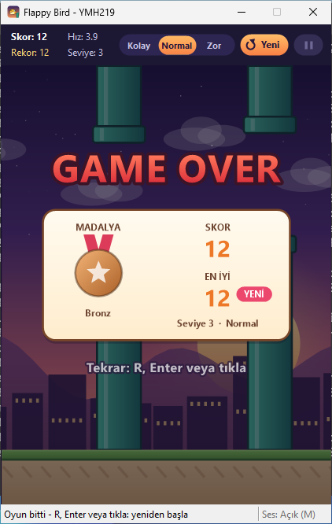
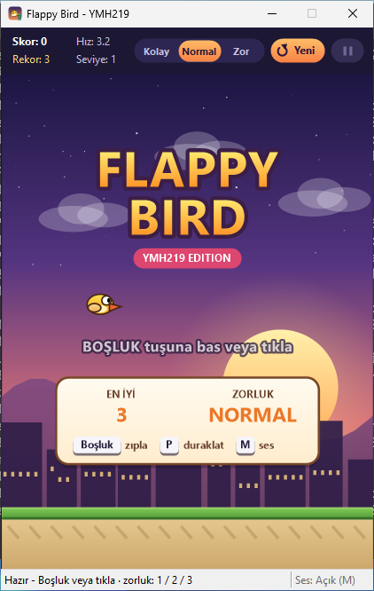
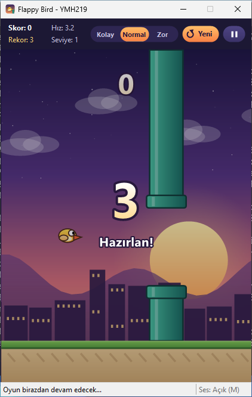

# YMH219 - Flappy Bird

[](https://github.com/ozenyunus35/YMH219-FlappyBird/actions/workflows/build.yml)

Nesne Tabanlı Programlama (YMH 219) dersi ek uygulama ödevi.
Windows Forms ile yazılmış, gün batımı temalı bir Flappy Bird benzeri oyun.
Kuş, borular, şehir silueti, madalyalar ve tüm arayüz tamamen kodla (GDI+) çiziliyor; projede ikon dışında hiç resim dosyası yok.

<p align="center">
  
  
</p>

## Kullanılan Teknolojiler

- C# / .NET 10 (`net10.0-windows`)
- Windows Forms
- `System.Windows.Forms.Timer` (oyun döngüsü, ~60 FPS)
- GDI+ (`System.Drawing`) ile çizim
- Uygulamada harici NuGet paketi **kullanılmadı**
- Testler: xUnit (`FlappyBird.Tests` projesi)
- GitHub Actions (her push'ta Windows üzerinde derleme + test)

## Kurulum ve Çalıştırma

**Visual Studio ile**

1. Depoyu klonlayın ya da ZIP olarak indirin.
2. `YMH219-FlappyBird.sln` dosyasını Visual Studio ile açın.
3. Başlangıç projesinin **FlappyBird** olduğundan emin olun (Solution Explorer'da sağ tık → *Set as Startup Project*).
4. `F5` ile çalıştırın.

**Komut satırı ile**

```bash
git clone https://github.com/ozenyunus35/YMH219-FlappyBird.git
cd YMH219-FlappyBird
dotnet run --project FlappyBird
```

**Testleri çalıştırmak için**

```bash
dotnet test
```

Visual Studio'da: *Test → Run All Tests*.

> Gereksinim: Windows + .NET 10 SDK. (`RollForward=Major` ayarı sayesinde daha yeni .NET sürümleriyle de açılır.)

## Kontroller

| Tuş | İşlev |
|-----|-------|
| `Boşluk` / `↑` / `W` / sol tık | Zıpla (oyunu başlatır) |
| `P` / `Esc` | Duraklat / devam et (duraklatılmışken tıklamak da devam ettirir) |
| `R` | Yeni oyun |
| `M` | Ses efektlerini aç / kapat (durum çubuğundaki "Ses" yazısına tıklamak da olur) |
| `Enter` / sol tık | Oyun bittiyse yeniden başla |
| `1` / `2` / `3` | Zorluk: Kolay / Normal / Zor |

Üst çubuktaki **Kolay / Normal / Zor** seçicisi, **Yeni** ve **⏸** butonları da aynı işleri yapıyor (üzerine gelince ipucu çıkıyor).
Oyun sürerken zorluk değiştirilirse skor kaybolacağı için önce onay soruluyor.

## Özellikler

- Kuş tuşa basınca yukarı zıplıyor, yer çekimiyle aşağı düşüyor
- Aynı anda 3 boru çifti sağdan sola kayıyor; ekrandan çıkan boru silinmeden sağa geri konumlanıyor
- Boruya veya zemine çarpınca oyun duruyor ve **Game Over** paneli çıkıyor
- Geçilen her boru +1 skor
- Her 5 puanda hız artıyor (seviye atlama)
- 3 zorluk seviyesi: Kolay / Normal / Zor (boşluk boyu, hız ve yer çekimi değişiyor)
- En yüksek skor her zorluk için ayrı olarak dosyaya kaydediliyor
- Oyun sonu ses efekti (`SystemSounds`), `M` ile kapatılabiliyor
- Pencere başka bir uygulamaya geçince oyun otomatik duraklıyor

**Ek özellikler (ödevde istenenlerin dışında)**

- Logolu **açılış ekranı** (en iyi skor, seçili zorluk ve tuş ipuçları ile)
- Katmanlı **paralaks manzara**: yıldızlar, tepeler, ışıkları yanan şehir silueti, bulutlar
- Skor alınca **+1** efekti, çarpınca beyaz **flaş** ve kısa **ekran sarsıntısı**
- Özel çizilmiş arayüz kontrolleri: zorluk seçici (`ZorlukSecici`) ve ikonlu butonlar (`OyunButonu`)
- Uygulama ikonu

- Duraklatmadan dönünce 3-2-1 **geri sayım**, oyuncu hazırlanmadan oyun başlamıyor
- Skora göre **madalya**: 10 puan bronz, 20 puan gümüş, 40 puan altın
- **Sabit zaman adımı**: oyun hızı bilgisayarın hızından ve timer gecikmesinden bağımsız (saniyede 60 adım)
- Bozuk rekor dosyasına karşı koruma (hatalı satırlar atlanıyor)
- 41 adet otomatik birim testi

## Proje Yapısı

```
FlappyBird/
├── Program.cs
├── MainForm.cs / MainForm.Designer.cs   -> form, butonlar, klavye olayları
├── Kontroller/
│   ├── OyunAlani.cs        -> oyunun çizildiği özel kontrol (OnPaint)
│   ├── Cizim.cs            -> kenarlı yazı, kart, tuş gibi çizim yardımcıları
│   ├── ZorlukSecici.cs     -> Kolay/Normal/Zor seçici (ComboBox yerine)
│   └── OyunButonu.cs       -> ikonlu, yuvarlak buton (Button'dan türetildi)
├── Oyun/
│   ├── Kus.cs              -> konum, dikey hız, zıplama, yer çekimi
│   ├── Boru.cs             -> üst/alt parça, kayma, yeniden konumlanma
│   ├── OyunMotoru.cs       -> skor, hız, çarpışma, oyun durumu
│   ├── OyunDurumu.cs       -> Hazir / Oynaniyor / Duraklatildi / GeriSayim / Bitti
│   ├── Zorluk.cs           -> zorluk seviyeleri ve ayarları
│   └── Madalya.cs          -> skora göre madalya hesabı
└── Veri/
    └── RekorDeposu.cs      -> rekorları txt dosyasına okuma/yazma

FlappyBird.Tests/
├── KusVeBoruTestleri.cs
├── OyunMotoruTestleri.cs
└── RekorDeposuTestleri.cs
```

Oyun kuralları `OyunMotoru` sınıfında. Form tarafı her `Timer.Tick`'te geçen süreyi ölçüp o kadar `motor.Ilerle()` adımı çalıştırıyor ve ekranı yeniliyor.
Motor; skor değişince, durum değişince ve oyun bitince **event** ile formu haberdar ediyor.

## Ekran Görüntüleri

| Başlangıç | Oyun | Duraklatıldı |
|:-:|:-:|:-:|
|  |  |  |

| Geri sayım | Game Over + madalya |
|:-:|:-:|
|  |  |

## Testler

`FlappyBird.Tests` projesinde oyun mantığı için xUnit testleri var. Örneğin:

- Zıplamadan bırakılan kuşun zemine çarpıp oyunu bitirmesi (`OyunBitti` event'i tek sefer)
- Borudan geçince skorun artması, her 5 puanda hızın artması
- Ekrandan çıkan borunun sağa geri konumlanması ve boşluk farkının 150 pikseli geçmemesi
- Duraklatınca hiçbir şeyin hareket etmemesi, geri sayımın 3 saniye sürmesi
- Rekorun dosyaya yazılıp tekrar okunması, bozuk dosyada programın çökmemesi

Testler GitHub Actions üzerinde her push'ta Windows'ta otomatik çalışıyor (yukarıdaki rozet).

## Bilinen Sınırlamalar / Notlar

- Windows Forms kullanıldığı için uygulama yalnızca **Windows**'ta çalışır.
- Ekran görüntüleri ve GIF, GitHub Actions'ın Windows makinesinde uygulama çalıştırılarak alındı.
- Rekor dosyası: `%AppData%\YMH219-FlappyBird\rekorlar.txt`. Dosya silinirse rekorlar sıfırlanır.
- İleride eklenebilecekler: kuş için sprite animasyonu, ses dosyaları ile müzik, en iyi 5 skor listesi.

## Öğrenci

| | |
|---|---|
| Ad Soyad | **Yunus Emre Özen** |
| Öğrenci No | **215542001** |
| Ders | YMH219 Nesne Tabanlı Programlama |
