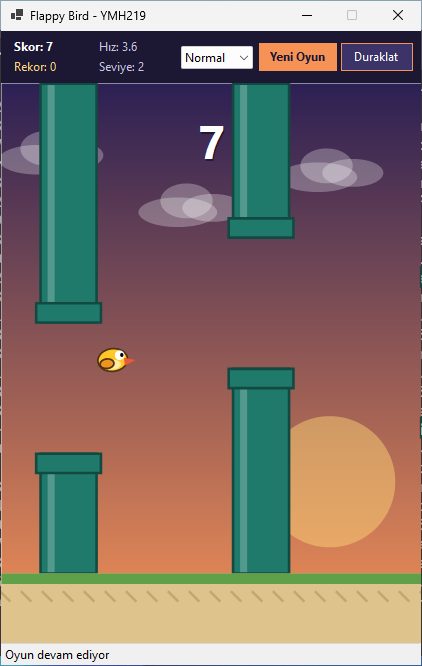
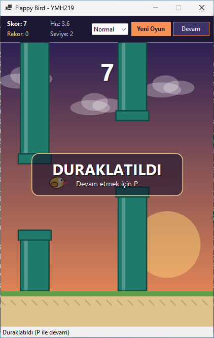

# YMH219 - Flappy Bird

Nesne Tabanlı Programlama (YMH 219) dersi ek uygulama ödevi.
Windows Forms ile yazılmış, gün batımı temalı basit bir Flappy Bird benzeri oyun.
Kuş, borular, zemin ve arka plan tamamen kodla (GDI+) çiziliyor, projede hiç resim dosyası yok.

<p align="center">
  
  
</p>

## Kullanılan Teknolojiler

- C# / .NET 10 (`net10.0-windows`)
- Windows Forms
- `System.Windows.Forms.Timer` (oyun döngüsü, ~60 FPS)
- GDI+ (`System.Drawing`) ile çizim
- Harici NuGet paketi **kullanılmadı**

## Kurulum ve Çalıştırma

**Visual Studio ile**

1. Depoyu klonlayın ya da ZIP olarak indirin.
2. `YMH219-FlappyBird.sln` dosyasını Visual Studio ile açın.
3. `F5` ile çalıştırın.

**Komut satırı ile**

```bash
git clone https://github.com/ozenyunus35/YMH219-FlappyBird.git
cd YMH219-FlappyBird
dotnet run --project FlappyBird
```

> Gereksinim: Windows + .NET 10 SDK. (`RollForward=Major` ayarı sayesinde daha yeni .NET sürümleriyle de açılır.)

## Kontroller

| Tuş | İşlev |
|-----|-------|
| `Boşluk` / `↑` / `W` / sol tık | Zıpla (oyunu başlatır) |
| `P` / `Esc` | Duraklat / devam et |
| `R` | Yeni oyun |
| `Enter` | Oyun bittiyse yeniden başla |

Üst paneldeki **Yeni Oyun** ve **Duraklat** butonları ve zorluk seçimi de aynı işleri yapıyor.

## Özellikler

- Kuş tuşa basınca yukarı zıplıyor, yer çekimiyle aşağı düşüyor
- Aynı anda 3 boru çifti sağdan sola kayıyor; ekrandan çıkan boru silinmeden sağa geri konumlanıyor
- Boruya veya zemine çarpınca oyun duruyor ve **Game Over** paneli çıkıyor
- Geçilen her boru +1 skor
- Her 5 puanda hız artıyor (seviye atlama)
- 3 zorluk seviyesi: Kolay / Normal / Zor (boşluk boyu, hız ve yer çekimi değişiyor)
- En yüksek skor her zorluk için ayrı olarak dosyaya kaydediliyor
- Oyun sonu ses efekti (`SystemSounds`)
- Pencere başka bir uygulamaya geçince oyun otomatik duraklıyor

## Proje Yapısı

```
FlappyBird/
├── Program.cs
├── MainForm.cs / MainForm.Designer.cs   -> form, butonlar, klavye olayları
├── Kontroller/
│   └── OyunAlani.cs        -> oyunun çizildiği özel kontrol (OnPaint)
├── Oyun/
│   ├── Kus.cs              -> konum, dikey hız, zıplama, yer çekimi
│   ├── Boru.cs             -> üst/alt parça, kayma, yeniden konumlanma
│   ├── OyunMotoru.cs       -> skor, hız, çarpışma, oyun durumu
│   ├── OyunDurumu.cs       -> Hazir / Oynaniyor / Duraklatildi / Bitti
│   └── Zorluk.cs           -> zorluk seviyeleri ve ayarları
└── Veri/
    └── RekorDeposu.cs      -> rekorları txt dosyasına okuma/yazma
```

Oyun kuralları `OyunMotoru` sınıfında, form tarafı sadece her `Timer.Tick`'te `motor.Ilerle()` çağırıp ekranı yeniliyor.
Motor; skor değişince, durum değişince ve oyun bitince **event** ile formu haberdar ediyor.

## Ekran Görüntüleri

| Başlangıç | Oyun | Duraklatıldı | Game Over |
|:-:|:-:|:-:|:-:|
|  |  |  |  |

## Bilinen Sınırlamalar / Notlar

- Windows Forms kullanıldığı için uygulama yalnızca **Windows**'ta çalışır.
- Fizik hesabı kare başına yapılıyor; Windows timer çözünürlüğü (~15 ms) yüzünden çok yavaş bilgisayarlarda oyun biraz yavaşlayabilir.
- Rekor dosyası: `%AppData%\YMH219-FlappyBird\rekorlar.txt`. Dosya silinirse rekorlar sıfırlanır.
- İleride eklenebilecekler: kuş için sprite animasyonu, ses dosyaları ile müzik, en iyi 5 skor listesi.

## Öğrenci

**Yunus Emre Özen**
